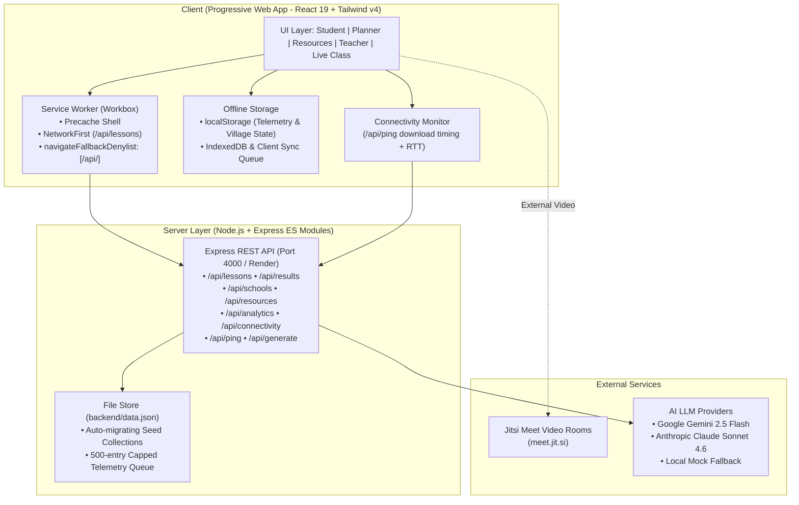

# GramShiksha (ग्रामशिक्षा)

> **Offline-first learning and infrastructure planning platform for rural Indian schools.** Built for intermittent connectivity, multi-grade classrooms, and resource-constrained environments aligned with India's **Samagra Shiksha** mission.

### 🌐 Live Deployment
* **Live App (Vercel):** [https://gram-shiksha-mu.vercel.app](https://gram-shiksha-mu.vercel.app)
* **Backend API (Render):** [https://gramshiksha-vbcj.onrender.com](https://gramshiksha-vbcj.onrender.com)

> ⏳ **Note:** The backend is hosted on Render's free tier, which spins down when idle. The initial load or first API call may take approximately 50–60 seconds while the server wakes up.

---

## 1. Problem Statement

Initiated under the **Ministry of Education's Samagra Shiksha Abhiyan (Department of School Education & Literacy — DoSEL, 2024)**, this initiative addresses the critical digital divide in India's rural schooling infrastructure. Millions of rural students across government schools face severe constraints: cellular connectivity fluctuates between 0 and 5 Mbps with high network downtime, schools face acute shortages of textbooks and learning hardware, and teachers in multi-grade classrooms lack automated bilingual curriculum tools. GramShiksha delivers a resilient, offline-first learning system alongside administrative visibility for targeted resource allocation.

---

## 2. Solution Overview

GramShiksha addresses all three tiers of rural schooling:
* **For Students:** An offline-first Progressive Web App (PWA) with cached bilingual lessons (English & Hindi), local interactive comprehension quizzes, and automatic background synchronization upon network reconnection.
* **For Teachers:** An AI-powered lesson and assessment studio that digests raw textbook chapters and generates 6th–8th grade bilingual lessons with 5 MCQs, providing full human-in-the-loop review before publishing.
* **For Administrators & Planners:** A centralized decision dashboard calculating multi-factor priority scores (0–100) to pinpoint schools needing urgent hardware or academic interventions, coupled with live device telemetry and real-time inventory tracking.

---

## 3. Solution Areas Mapping

| # | Solution Area (MoE / Samagra Shiksha) | Implementation Status | Implementation Details & File / Route References |
|---|---------------------------------------|:---------------------:|--------------------------------------------------|
| **1** | **Virtual Classroom** | **Partial** | Provides standard-wise (Classes 6, 7, 8) one-click video rooms with copyable links and offline guardrails. *Marked Partial* because it integrates with public Jitsi Meet infrastructure (`https://meet.jit.si/GramShiksha-<slug>-class<N>`) rather than a self-hosted custom WebRTC server. <br>`frontend/src/pages/LiveClass.jsx` |
| **2** | **Resource Management** | **Implemented** | Central inventory tracking across 8 seeded village schools for 5 essential items (textbooks, tablets, projectors, science kits, solar chargers). Features school-level filtering, automatic gap detection (`needed > stock`) with red highlights, and optimistic inline `+/-` stock adjustment with persistence. <br>`frontend/src/pages/Resources.jsx`, `GET /api/resources`, `PATCH /api/resources/:id` |
| **3** | **Connectivity Optimization** | **Implemented** | Real-time active bandwidth measurement via 100 KB un-cached payload (`/api/ping`) and RTT capture, with fallback to `navigator.connection`. Offline samples are queued in `localStorage` (capped at 50) and flushed upon reconnection. Displays live bandwidth badges in the header and reports telemetry to the backend. <br>`frontend/src/lib/connectivity.js`, `GET /api/ping`, `GET/POST /api/connectivity` |
| **4** | **E-Learning Content Creation** | **Implemented** | Teacher studio that accepts raw chapter text (up to 8,000 characters) and generates bilingual summaries (English + Hindi) and 5 comprehension MCQs via Google Gemini 2.5 Flash or Anthropic Claude Sonnet 4.6 (with built-in offline demo fallback). Includes an interactive preview editor to modify questions/answers prior to student publication. <br>`frontend/src/pages/Teacher.jsx`, `POST /api/generate`, `POST /api/lessons` |
| **5** | **Mobile Offline Learning** | **Implemented** | Lightweight PWA with Service Worker precaching and Workbox runtime caching for `/api/lessons`. Supports offline lesson reading, dual-language display, instant client-side quiz scoring, and queuing of quiz submissions with automatic sync when online. <br>`frontend/src/pages/Student.jsx`, `frontend/vite.config.js`, `GET /api/lessons`, `POST /api/results` |
| **6** | **Data Analytics for Infrastructure Planning** | **Implemented** | District planner dashboard with 4 high-level KPI cards, Recharts visualizations for village quiz mastery and internet bandwidth, live device speed and uptime telemetry, and an automated 0–100 weighted priority score ranking schools needing immediate intervention. <br>`frontend/src/pages/Planner.jsx`, `backend/server.js` (`GET /api/analytics`) |

---

## 4. Architecture



### Offline-First Synchronization Flow
1. **Initial Online Visit:** The Service Worker precaches the application shell and assets. The student catalog `/api/lessons` is fetched and cached via `NetworkFirst` caching.
2. **Transitioning Offline:** The browser's native `online`/`offline` window events toggle the global status badge to `Offline`. When taking a quiz or measuring connectivity without internet, submissions are evaluated locally and appended to the respective local queues.
3. **Reconnection & Sync:** Upon restoring connectivity, the synchronization engine flushes pending telemetry batches to `POST /api/connectivity` and queued quiz attempts to `POST /api/results`. The header sync indicator briefly displays `Syncing...` before returning to `Synced`, immediately updating district-wide analytics.

---

## 5. Key Features

* **Offline Lessons & Quizzes with Background Sync:** Students can browse lessons and submit quiz answers even when disconnected; submissions queue locally and automatically sync once connectivity returns.
* **Bilingual English & Hindi Curriculum:** Every lesson presents a 4–5 sentence simple English summary alongside a parallel Hindi summary (`हिंदी सारांश`) to bridge vernacular learning gaps.
* **AI Lesson & Assessment Generator with Human Review:** Teachers paste chapter text to auto-generate bilingual lesson summaries and 5 curriculum-aligned MCQs with options and answers, fully editable before publishing.
* **Planner Dashboard with Priority Scoring:** Administrators can review an automated 0–100 deficiency score per school factoring in internet bandwidth, network downtime, textbook/hardware shortages, and village quiz comprehension.
* **Real-Time School Resource Tracker:** Interactive inventory table highlighting hardware and textbook deficits in red, with optimistic `+` / `-` stock adjustments persisting instantly to the backend.
* **Live Field Connectivity Telemetry:** Devices continuously measure download throughput using 100 KB payload tests and log latency, uptime percentage, and last-seen timestamps to the planner dashboard.
* **One-Click Virtual Classroom via Jitsi:** Low-friction, standards-based video conferencing rooms for Classes 6, 7, and 8 with automated offline fallbacks directing students to cached lessons.

---

## 6. Screenshots

### Student Learning Center


### District Planner Dashboard


### AI Teacher Studio


### School Resource Tracker


---

## 7. Tech Stack

* **Frontend:**
  * **Framework:** React 19, Vite 8
  * **Styling:** Tailwind CSS v4 (using `@tailwindcss/vite` CSS-first engine)
  * **Data Visualization:** Recharts
  * **PWA & Offline:** `vite-plugin-pwa`, Workbox, Service Workers
  * **Hosting:** Vercel
* **Backend:**
  * **Runtime:** Node.js (ES Modules)
  * **Server Framework:** Express 5
  * **Storage:** File-based JSON storage (`backend/data.json`) with auto-seeding and defensive collection migration
  * **AI Integration:** Google Gemini 2.5 Flash (`generativelanguage.googleapis.com`), Anthropic Claude Sonnet 4.6 (`api.anthropic.com`), Native Fetch
  * **Hosting:** Render

---

## 8. Running Locally

### Prerequisites
* **Node.js:** v20.x or higher
* **npm:** v10.x or higher

### Step 1: Clone Repository
```bash
git clone https://github.com/Frxzlr/GramShiksha.git
cd GramShiksha
```

### Step 2: Start the Backend
```bash
cd backend
npm install

# (Optional) Add your API key for live AI generation in backend/.env
# This file is strictly gitignored and must never be committed:
# echo "GEMINI_API_KEY=your_gemini_api_key_here" >> .env
# OR
# echo "ANTHROPIC_API_KEY=your_anthropic_api_key_here" >> .env

npm run dev
```
* The API server will start on `http://localhost:4000`.
* If no API key is provided, the AI lesson generator runs in **Demo Mode** with realistic offline mock curriculum.

### Step 3: Start the Frontend
In a new terminal window:
```bash
cd frontend
npm install
npm run dev
```
* The frontend PWA will start on `http://localhost:5173`.
* Vite automatically proxies `/api` requests to `http://localhost:4000`.

---

## 9. Demo Walkthrough

Experience the complete end-to-end GramShiksha workflow in 5 steps:

1. **Step 1: Inspect High-Need Schools (Planner Tab)**
   * Open the **Planner** tab.
   * View the 4 top KPI cards (Schools, Students, Quiz Attempts, Average Score).
   * Review the **Schools Needing Attention** list: observe schools like *Govt Primary School Bargi* flagged with priority scores (>90) due to 0 Mbps connectivity, high downtime, and textbook shortages.
2. **Step 2: Generate & Publish a Lesson (Teacher Tab)**
   * Switch to the **Teacher** tab.
   * Paste a textbook passage (minimum 40 characters) into the chapter text box.
   * Click **Generate lesson + quiz**. In demo mode, an amber badge confirms sample generation.
   * Review the generated English summary, Hindi summary (`हिंदी सारांश`), and 5 editable multiple-choice questions.
   * Make any edits and click **Publish to students**.
3. **Step 3: Browse the Lesson Online (Student Tab)**
   * Switch to the **Student** tab.
   * Notice the newly published lesson appears as a pill button in the lesson selector.
   * Select it to view the full lesson content and quiz questions while online.
4. **Step 4: Go Offline & Complete the Quiz**
   * Open Chrome DevTools (`F12` or `Cmd+Option+I`) -> Navigate to the **Network** tab -> Set throttling to **Offline**.
   * Observe the header status badge switch from green **Online** to amber **Offline**.
   * Answer the 5 multiple-choice questions and click **Submit Answers**.
   * The quiz is graded instantly client-side with a local score badge, and the attempt is queued.
5. **Step 5: Reconnect & Verify Sync**
   * Switch the DevTools Network dropdown back to **No throttling** (Online).
   * Observe the status badge return to green **Online** and the sync badge briefly show **Syncing...** then **Synced**.
   * Switch back to the **Planner** tab: observe the total Quiz Attempts counter and average scores update in real time.

---

## 10. Roadmap & Future Work

The following enhancements are actively planned for future development:
* **SQLite Embedded Device Database:** Transition from in-memory localStorage to an embedded SQLite client database for local persistence across thousands of multi-grade lesson modules.
* **Central Ministry Database Sync:** Multi-master transactional synchronization engine connecting village nodes to state and national DoSEL data warehouses.
* **Unity Cardboard VR Science Lab:** Offline WebXR / Google Cardboard virtual science experiment modules for low-cost Android smartphones without dedicated lab apparatus.
* **Adaptive AI Tutor:** Micro-model on-device personalization adapting quiz difficulty and Hindi explanations based on student error patterns.
* **SMS & Ultra-Low-Bandwidth Modes:** Two-way SMS/USSD quiz submission channels for remote tribal areas with zero packet data coverage.

---

## 11. License

Licensed under the [MIT License](LICENSE). Developed for rural public education infrastructure.
